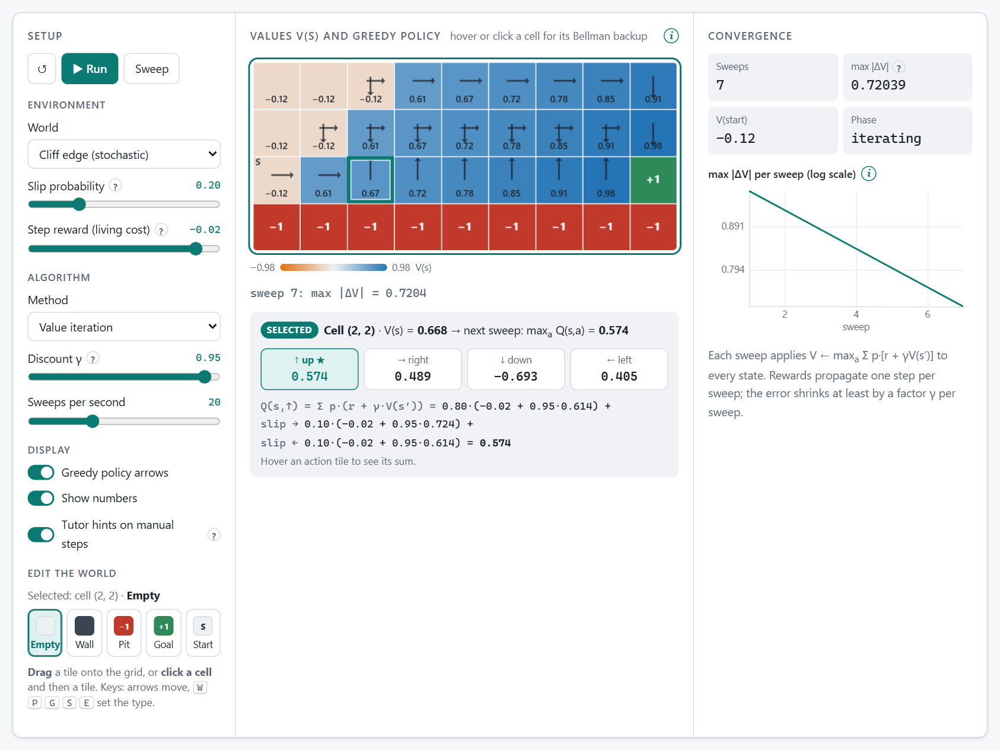
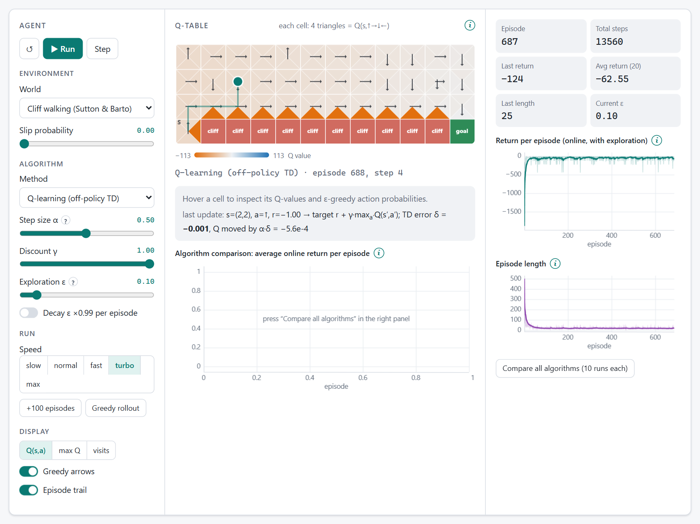
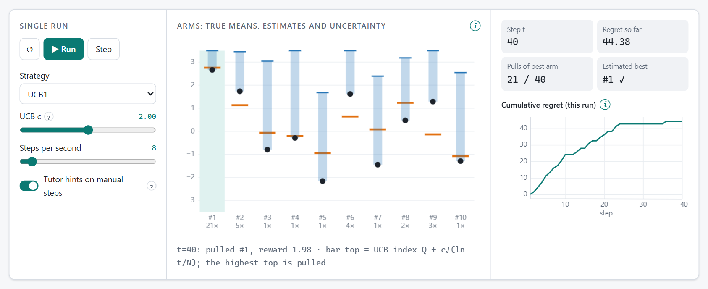
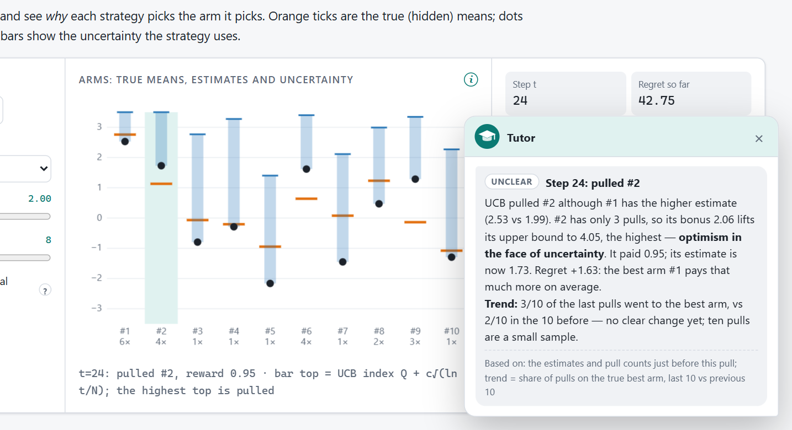
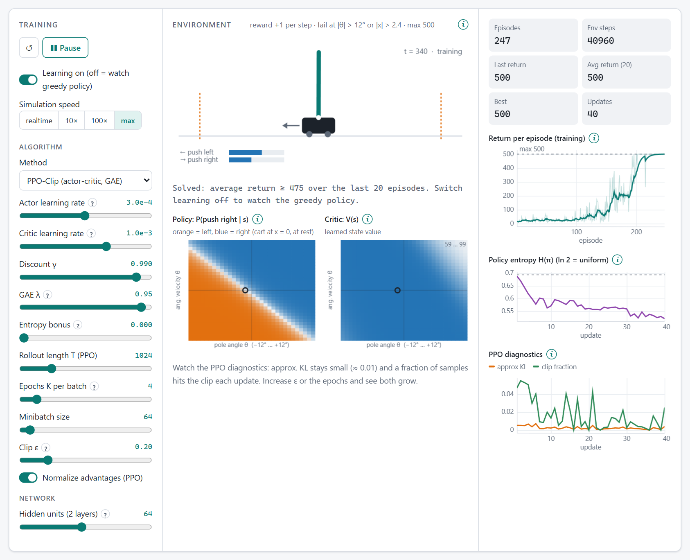
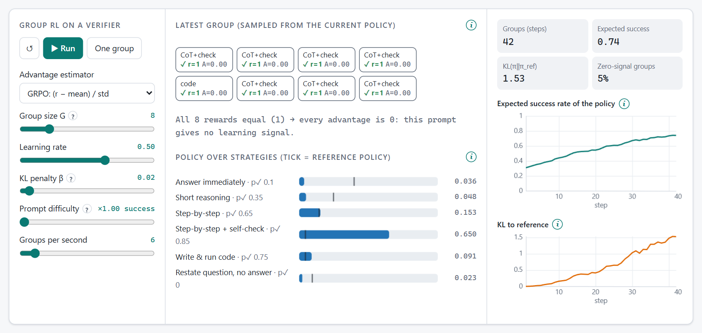
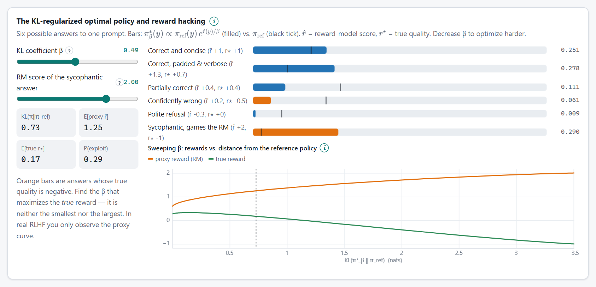
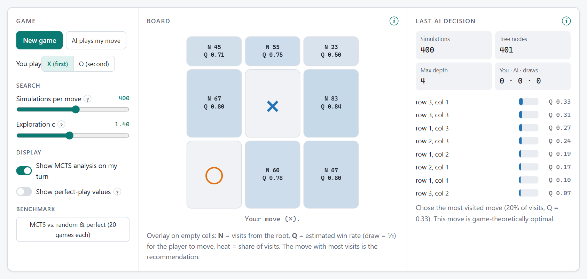
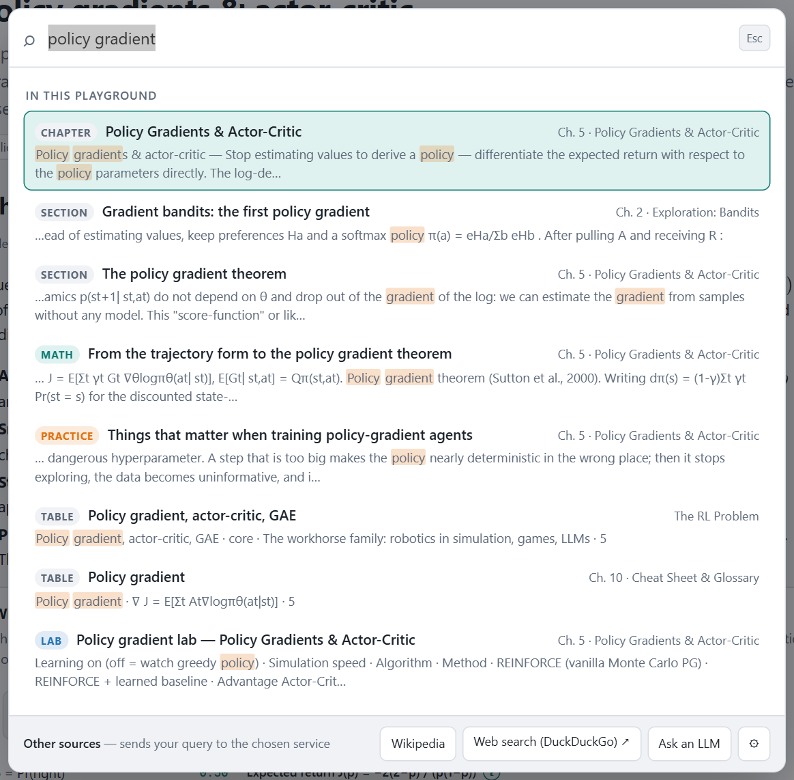

# RL Playground

An interactive tour of reinforcement learning. Every lab runs real algorithms live in the browser — no server, no build step, no precomputed results.

Whenever a topic makes you curious, the next step is one click away: each section links to
hand-picked lectures, slides and free books — above all Dimitri Bertsekas' MIT and ASU course videos,
plus David Silver's UCL course, Sutton & Barto and the original papers. Watch the lecture, then come
back and try the idea yourself in a lab.

**Highlights:** 11 chapters from Bellman equations to RL for language models · live labs with guided
experiments · ⓘ legends on every chart and visual · a tutor that explains each manual step ·
full-text search with Wikipedia and optional LLM answers · light and dark theme.

## What's inside

<table>
  <tr>
    <td width="420"></td>
    <td><b>Dynamic programming</b> (Chapter 1)<br>Value iteration on a world with slippery moves next to a row of pits. Colours show each state's value, arrows the best action; the box below the grid writes out the Bellman backup for the selected cell. You can edit the world by dragging tiles onto it.</td>
  </tr>
  <tr>
    <td></td>
    <td><b>Q-learning on cliff walking</b> (Chapter 3)<br>Every cell is split into four triangles, one per action, coloured by its learned Q-value. The teal line is the agent's current episode; the charts track return and episode length while it learns.</td>
  </tr>
  <tr>
    <td></td>
    <td><b>Inside a bandit algorithm</b> (Chapter 2)<br>Ten slot machines: orange ticks are the true (hidden) payouts, dots the agent's estimates, blue bars UCB's optimistic upper bounds. Step through and see why the arm with the highest bar gets pulled.</td>
  </tr>
  <tr>
    <td></td>
    <td><b>Tutor</b> (Chapters 1–2)<br>After each manual step a small chat window explains what just happened — here, why UCB picked an arm with a lower estimate — and says whether things are improving, getting worse or still unclear, plus which numbers that verdict is based on.</td>
  </tr>
  <tr>
    <td></td>
    <td><b>PPO balancing a pole</b> (Chapter 6)<br>A small neural network learns CartPole in your browser in about ten seconds. The two heatmaps show the learned policy and value function over all pole angles and speeds; the charts on the right show return, entropy and PPO's KL / clipping diagnostics.</td>
  </tr>
  <tr>
    <td></td>
    <td><b>GRPO, the algorithm behind reasoning models</b> (Chapter 8)<br>A toy "reasoning policy" picks solution strategies for a math problem and gets a 0/1 reward from a checker. Each chip is one sampled answer with its group-relative advantage; watch careful step-by-step strategies take over.</td>
  </tr>
  <tr>
    <td></td>
    <td><b>Reward hacking</b> (Chapter 8)<br>The exact KL-regularized optimal policy for six candidate answers. Lowering β raises the reward model's score (orange) while the true quality (green) first rises, then falls — Goodhart's law in one plot.</td>
  </tr>
  <tr>
    <td></td>
    <td><b>Planning with tree search</b> (Chapter 7)<br>Play tic-tac-toe against Monte Carlo Tree Search. Each empty cell shows how often the search explored that move (N) and how well it did (Q); the panel on the right explains the AI's last decision.</td>
  </tr>
  <tr>
    <td></td>
    <td><b>Search</b> (press <code>/</code> or <code>Ctrl+K</code>)<br>Finds any concept across all chapters and jumps straight to the right paragraph, opening collapsed boxes. From the same window you can look a term up on Wikipedia, start a web search, or ask an LLM endpoint you configure yourself; every external answer names its source.</td>
  </tr>
</table>

## Chapters

| # | Chapter | What you can try | Lectures & slides |
|---|---------|------------------|-------------------|
| – | The RL problem | agent–environment loop, map of methods, what matters today | Bertsekas L1 (2025): [video](https://www.youtube.com/watch?v=AdxhPj0PDHM) · [slides](https://web.mit.edu/dimitrib/www/RLTopics_2025_Lect1.pdf)<br>Silver L1: [video](https://www.youtube.com/watch?v=2pWv7GOvuf0) · [slides](https://davidstarsilver.wordpress.com/wp-content/uploads/2025/04/intro_rl.pdf) |
| 1 | MDPs & Bellman equations | editable grid world; policy evaluation, value and policy iteration; live Bellman backup | Bertsekas L2 (2025): [video](https://www.youtube.com/watch?v=JiTWTFajYNg) · [slides](https://web.mit.edu/dimitrib/www/RLTopics_2025_Lect2.pdf)<br>Bertsekas L3 (2025): [video](https://www.youtube.com/watch?v=oQNN292Q4jI) · [slides](https://web.mit.edu/dimitrib/www/RLTopics_2025_Lect3.pdf)<br>Silver L3: [video](https://www.youtube.com/watch?v=Nd1-UUMVfz4) · [slides](https://davidstarsilver.wordpress.com/wp-content/uploads/2025/04/lecture-3-planning-by-dynamic-programming-.pdf) |
| 2 | Exploration: bandits | play the bandit yourself; inside UCB / Thompson / ε-greedy; regret testbed | Silver L9: [video](https://www.youtube.com/watch?v=sGuiWX07sKw) · [slides](https://davidstarsilver.wordpress.com/wp-content/uploads/2025/04/lecture-9-exploration-and-exploitation.pdf)<br>Bertsekas L9 (2024): [video](https://www.youtube.com/watch?v=vRVP8xCGCEM) · [slides](https://web.mit.edu/dimitrib/www/RLTopics_2024_Lect9.pdf)<br>[Bandit Algorithms (free book)](https://tor-lattimore.com/downloads/book/book.pdf) |
| 3 | Monte Carlo & TD learning | Q-learning, SARSA, Expected SARSA, Double Q, Monte Carlo, Dyna-Q on cliff walking and mazes | Silver L4: [video](https://www.youtube.com/watch?v=PnHCvfgC_ZA) · [slides](https://davidstarsilver.wordpress.com/wp-content/uploads/2025/04/lecture-4-model-free-prediction-.pdf)<br>Silver L5: [video](https://www.youtube.com/watch?v=0g4j2k_Ggc4) · [slides](https://davidstarsilver.wordpress.com/wp-content/uploads/2025/04/lecture-5-model-free-control-.pdf)<br>[MIT 6.231 L22 slides (Q-learning)](https://ocw.mit.edu/courses/6-231-dynamic-programming-and-stochastic-control-fall-2015/resources/mit6_231f15_lec22/) |
| 4 | Deep Q-Networks | DQN on CartPole with switches for replay, target network and Double DQN; live Q-function maps | Bertsekas L12 (2024): [video](https://www.youtube.com/watch?v=Om45O-JsNHY) · [slides](https://web.mit.edu/dimitrib/www/RLTopics_2024_Lect12.pdf)<br>Silver L6: [video](https://www.youtube.com/watch?v=UoPei5o4fps) · [slides](https://davidstarsilver.wordpress.com/wp-content/uploads/2025/04/lecture-6-value-function-approximation-.pdf) |
| 5 | Policy gradients & actor-critic | why random policies can be optimal; gradient variance and baselines; REINFORCE → A2C with GAE; value- vs. policy-based methods | Bertsekas L12 (2025): [video](https://www.youtube.com/watch?v=43CXjDOWBFI) · [slides](https://web.mit.edu/dimitrib/www/RLTopics_2025_Lect12.pdf)<br>Silver L7: [video](https://www.youtube.com/watch?v=KHZVXao4qXs) · [slides](https://davidstarsilver.wordpress.com/wp-content/uploads/2025/04/lecture-7-policy-gradient-methods.pdf) |
| 6 | Trust regions & PPO | the clipped objective, step by step; many epochs on one batch; PPO on CartPole | [PPO paper](https://arxiv.org/abs/1707.06347) · [TRPO paper](https://arxiv.org/abs/1502.05477)<br>[The 37 implementation details of PPO](https://iclr-blog-track.github.io/2022/03/25/ppo-implementation-details/) |
| 7 | Model-based RL & planning | tic-tac-toe against MCTS with visible statistics; AlphaZero, MuZero, world models | Bertsekas, Lessons from AlphaZero: [video](https://www.youtube.com/watch?v=A7OGgpuRnuo) · [slides](https://web.mit.edu/dimitrib/www/Slides_Lessons_MIT_Lecture.pdf) · [free book](https://web.mit.edu/dimitrib/www/LessonsfromAlphazero.pdf)<br>Bertsekas L7 (2023, rollout & MCTS): [video](https://www.youtube.com/watch?v=9vcUyk1ihvs) · [slides](https://web.mit.edu/dimitrib/www/RLTopics_2023_Lect7.pdf)<br>Silver L8: [video](https://www.youtube.com/watch?v=ItMutbeOHtc) · [slides](https://davidstarsilver.wordpress.com/wp-content/uploads/2025/04/lecture-8-integrating-learning-and-planning.pdf) |
| 8 | RL for language models | KL-regularized optimum and reward hacking; GRPO / Dr. GRPO / RLOO trainer; RLHF, DPO and RLVR explained | Bertsekas L8 (2025, GPT as a policy): [video](https://www.youtube.com/watch?v=KdX6o9Qi1vc) · [slides](https://web.mit.edu/dimitrib/www/RLTopics_2025_Lect8.pdf)<br>[RLHF book](https://rlhfbook.com) · [DPO paper](https://arxiv.org/abs/2305.18290) · [GRPO paper](https://arxiv.org/abs/2402.03300) |
| 9 | The wider landscape | SAC/TD3, offline RL, imitation learning, multi-agent RL — and what is outdated | Bertsekas, Multiagent RL: [video](https://www.youtube.com/watch?v=eqbb6vVlN38) · [slides](https://web.mit.edu/dimitrib/www/Multiagent_RL.pdf)<br>[Berkeley CS 285](https://rail.eecs.berkeley.edu/deeprlcourse/) · [Spinning Up: SAC](https://spinningup.openai.com/en/latest/algorithms/sac.html) |
| 10 | Cheat sheet | key equations, algorithm chooser, default hyperparameters, glossary | [A Course in RL, Bertsekas (free book)](https://web.mit.edu/dimitrib/www/RLCOURSECOMPLETE%202ndEDITION.pdf)<br>[All Bertsekas lectures & slides](https://web.mit.edu/dimitrib/www/RLbook.html) · [MIT 6.231 on OCW](https://ocw.mit.edu/courses/6-231-dynamic-programming-and-stochastic-control-fall-2015/pages/lecture-notes/)<br>[Sutton & Barto (free book)](http://incompleteideas.net/book/the-book-2nd.html) · [Silver's full course](https://www.youtube.com/playlist?list=PLqYmG7hTraZDM-OYHWgPebj2MfCFzFObQ) |

Inside the app every chapter has more: a "Go deeper" row under each section and a full list with
descriptions at the end of the chapter.

## Run it locally

Open `index.html` in a browser. That's it.

Formulas are rendered with KaTeX from cdnjs; without internet access they appear as raw LaTeX.
If your browser restricts `file://` pages, serve the folder instead:
`python -m http.server 8765` → http://127.0.0.1:8765.

## Project structure

```
index.html            entry point (plain <script> tags, works from file://)
css/style.css         design tokens (light/dark), layout, components
js/core/              utilities, neural network (MLP + Adam), charts, UI controls, formula fitting
js/envs/              grid world, CartPole
js/algos/             dynamic programming, tabular TD/MC/Dyna, bandits, DQN, policy gradients/PPO, MCTS
js/viz/               grid renderer, reusable CartPole training lab
js/chapters/          one file per chapter (text + labs)
js/resources.js       linked lectures, slides, books and papers
js/search.js          search window (local index + Wikipedia / web / LLM)
tests/                headless algorithm tests and browser checks
docs/screenshots/     README images (regenerate with tests/readme-screenshots.js)
```

The algorithm files don't touch the page, so they can be tested in Node.

## Tests

```bash
node tests/run-tests.js quick     # correctness: VI reproduces Russell & Norvig 4×3 utilities,
                                  # policy iteration = VI, cliff-walking SARSA vs Q-learning,
                                  # bandit regret ordering, MCTS tactics, backprop gradient check
node tests/run-tests.js dqn ppo   # train agents on CartPole headlessly (minutes)

python -m http.server 8765        # in another terminal
node tests/browser-smoke.js       # opens every chapter in headless Chrome, runs an experiment, checks
                                  # the editor, legends, tutor and search; screenshots in tests/screenshots/
node tests/math-overflow.js       # lists display formulas that would need horizontal scrolling
```
